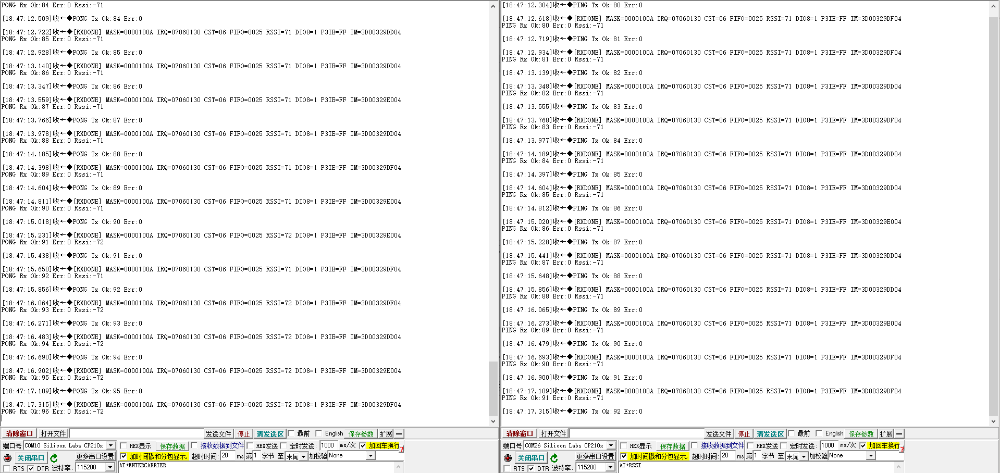

# Ai-SG01-P(PAN3120 + GC1131) on AI8051U —— AT 指令固件 + PING/PONG 对测

AT 指令固件在 AI8051U 上的移植版，并内置 PING/PONG 双板对测：上电按角色自动收发，不需要敲任何 AT 指令。

- 模组：Ai-SG01-P（PAN3120 + GC1131）
- MCU：AI8051U-34K64，33.1776 MHz，Keil C51（C351 编译器，Device `STC8051U-8Bit Series`）
- 工程：`AI8051U-AISG01.uvproj`
- 调试串口：UART1 = P3.7(TX) / P3.6(RX)，115200-8-N-1（波特率 33177600/9/32，TH1 = 0xF7，无误差）

---

## 1. 目录结构

```
AI8051U-Demo/
├── AI8051U-AISG01.uvproj      # Keil C51 工程
├── Source/
│   ├── main.c                 # 入口，只调 Firmware_App()
│   ├── firmware/at_command_firmware.c  # AT 固件主体（含 PINGPONG 状态机与 AT+PINGPONG）
│   ├── bsp/                   # bsp.c、bsp_uart、bsp_timer、bsp_led、bsp_flash
│   ├── pan312x/               # PAN312x 驱动、HAL 适配、RF CTK 表
│   ├── hal_compat/            # 把 STM32 HAL 调用映射到 8051 端口
│   └── XSFR_STC8051U_8Bit.H   # 寄存器/端口定义
├── Listings/                  # 编译中间产物
├── Objects/AI8051U-AISG01.hex # 已编译固件
└── README.md
```

## 2. 引脚

| 信号 | AI8051U | 说明 |
|------|---------|------|
| CSN | P1.4 | 软件片选（SPI 组 S0=0/S1=0） |
| MOSI | P1.5 | 推挽输出 |
| MISO | P1.6 | 高阻输入 |
| SCLK | P1.7 | 软件 SPI 时钟 |
| nRST | P3.5 | 复位，低有效 |
| DIO8 / IRQ | P3.2 | 中断输入 |
| 第二路 GPIO | P3.3 | 回调占位（token = GPIO_PIN_5） |
| UART1 TX / RX | P3.7 / P3.6 | 115200-8-N-1 |
| GREEN_LED / BLUE_LED | P2.0 / P2.1 | 高电平点亮 |

## 3. 角色配置（PING / PONG）

`g_pingpong_role` 默认 **1 = PONG（接收端）**，定义在 [`Source/firmware/at_command_firmware.c`](Source/firmware/at_command_firmware.c) 的 `PINGPONG_ROLE_DEFAULT`：

```c
#define PINGPONG_ROLE_DEFAULT 1   // 0 = PING 发送端，1 = PONG 接收端
```

- 烧两块板，一块 0、一块 1，上电即自动对测：PING 先发包等回包，PONG 收到回包，循环。
- 运行中也可用 `AT+PINGPONG 0|1` 改角色，`AT+PINGPONG?` 查询当前角色与运行状态。
- 串口会打印收发计数，用来判断链路是否稳定。

## 4. 射频参数

默认与 STM32 版一致：490.3 MHz、2FSK、50 kbps、频偏 25 kHz、`POWER_LDO_0402` + `POWER_20dBm`、发包周期 50 ms；配置存 Flash 最后一页，`AT+CONFIGSAVE` / `AT+CONFIGRESET` 生效。完整 AT 表用 `AT+HELP` 打印。

## 5. 编译与烧录

1. Keil C51（含 C351 编译器）打开 `AI8051U-AISG01.uvproj`，Device 选 `STC8051U-8Bit Series`。
2. Rebuild，产物 `Objects/AI8051U-AISG01.hex`（仓库内已附一份）。
3. 用 STC-ISP 下载，AI8051U 需按提示冷启动/重新上电。
4. 两块板分别烧 0 / 1 角色，接串口看对测计数。

## 6. 实测日志

两块 AI8051U 板（`COM10` / `COM26`）分别烧 PONG / PING，上电自动对测：`PONG Rx` 与 `PING Tx` 计数同步增长，`Err: 0`，RSSI 约 -71 dBm。



- 连续跑数百包没有出现 `Err` 非 0，说明 8051 侧软件 SPI + 中断回调在双向收发下没有丢中断。
- 两侧计数差保持在 1 以内，属于正常在途包。

## 7. 备注

- 只需要 AT 指令、不要自动对测时，把角色逻辑当作普通 AT 固件用即可；单载波测试见 [`../AI8051U-Single-Carrier/`](../AI8051U-Single-Carrier/)。
- STM32 上的同类对测见 [`../STM32F103C8T6-FreeRTOS-Demo/`](../STM32F103C8T6-FreeRTOS-Demo/)。
