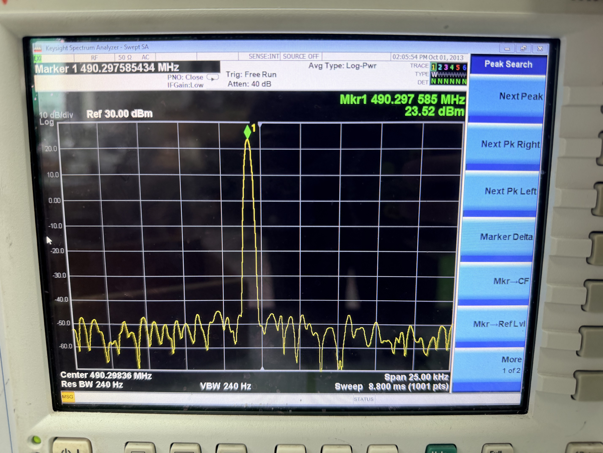

# Ai-SG01-P (PAN3120 + GC1131) on AI8051U — Single-Carrier (CW) Test

[](README.zh-CN.md)

The same AI8051U AT firmware with `CARRIER_AUTO_ON_BOOT` enabled: **on power-up it goes straight into an unmodulated single carrier**, equivalent to `AT+ENTERCARRIER`, for carrier power, frequency tolerance and spurious measurements.

- Module: Ai-SG01-P (PAN3120 + GC1131)
- MCU: AI8051U-34K64, 33.1776 MHz, Keil C51 (C351, Device `STC8051U-8Bit Series`)
- Project: `AI8051U-AISG01.uvproj`
- Debug UART: P3.7 / P3.6, 115200-8-N-1

---

## 1. Layout

```
AI8051U-Single-Carrier/
├── AI8051U-AISG01.uvproj
├── Source/
│   ├── main.c
│   ├── firmware/
│   │   ├── at_command_firmware.c   # AT firmware + single-carrier entry
│   │   └── carrier_config.h        # CARRIER_AUTO_ON_BOOT (default 1)
│   └── bsp/ pan312x/ hal_compat/   # same as the Demo project
├── Listings/
└── README.md
```

## 2. Pins

Identical to [`../AI8051U-Demo/`](../AI8051U-Demo/): CSN P1.4, MOSI P1.5, MISO P1.6, SCLK P1.7, nRST P3.5, IRQ P3.2, GPIO P3.3, UART P3.7/P3.6, LED P2.0/P2.1.

## 3. Carrier configuration

[`Source/firmware/carrier_config.h`](Source/firmware/carrier_config.h):

```c
#define CARRIER_AUTO_ON_BOOT   1   // 1 = enter CW at boot; 0 = back to the Demo auto test
```

When enabled, the boot sequence stops both timers, shuts down the Demo state machine and locks the RF state so nothing can rewrite it at runtime. Frequency and power come from the current `device_config` defaults:

| Item | Value |
|------|-------|
| Frequency | 490.3 MHz (`FrequencyBase = 490300000`) |
| Modulation | 2FSK (no modulation data loaded in CW) |
| Data rate / deviation | 50 kbps / 25 kHz (not visible in CW) |
| Power | `POWER_LDO_0402` + `POWER_20dBm` |

To change frequency or power, edit the defaults in `DeviceConfig_Init()` and rebuild; boards that already saved a Flash config read the old values back.

## 4. Runtime behaviour

- Power-up initialises the board peripherals → enters CW → the UART stays available for AT commands (but the RF state is frozen).
- The carrier is **unmodulated**, so the spectrum shows a single line; occupied bandwidth (OBW) requires continuous modulated transmission, which this project does not provide.
- Power down when the measurement is done.

## 5. Build and flash

1. Open `AI8051U-AISG01.uvproj` in Keil C51 and Rebuild.
2. Download the hex with STC-ISP, cold start / power cycle.
3. Connect the board to a spectrum analyser: first check the frequency is within the crystal tolerance of the setting, then check power and spurious emissions.

## 6. Spectrum measurement (narrow-span sweep)

Keysight swept spectrum analyser, Ref 30 dBm / 10 dB/div / 40 dB attenuation, centre 490.30 MHz, span 25 kHz, RBW = VBW 240 Hz; marker `Mkr1 490.297585 MHz`, peak **23.52 dBm**.



- A single line within 25 kHz, as expected for an unmodulated carrier; the occupied bandwidth is only tens of kHz, so this trace **cannot** be used to claim OBW.
- The measured frequency is about 2.4 kHz below the setting, which is within crystal tolerance; record the measured value in the certification report.

## 7. Notes

- For normal traffic or the two-board test, set `CARRIER_AUTO_ON_BOOT` to 0 or use [`../AI8051U-Demo/`](../AI8051U-Demo/).
- The equivalent STM32 + FreeRTOS firmware is in [`../STM32F103C8T6-FreeRTOS-Single-Carrier/`](../STM32F103C8T6-FreeRTOS-Single-Carrier/).
