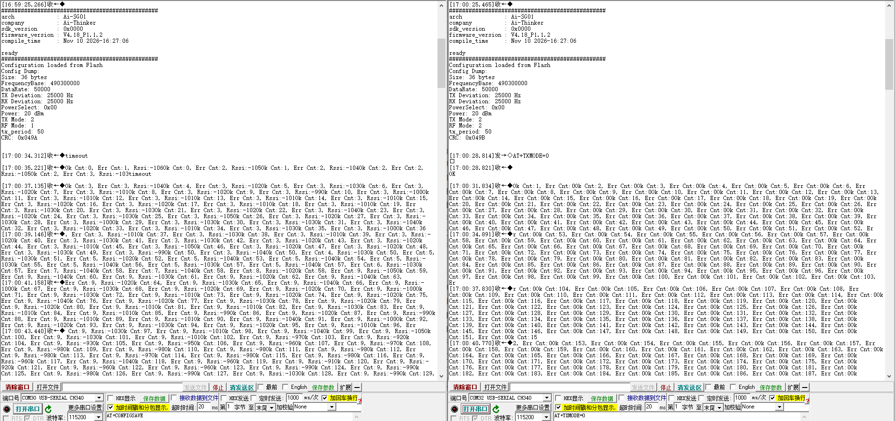

# Ai-SG01 (PAN3120) on STM32F103C8T6 + FreeRTOS — AT Command Firmware

[](README.zh-CN.md)

The Ai-SG01 AT firmware moved unchanged into a FreeRTOS task: `bsp_Init()` runs first, then the task is created and calls the original firmware entry `Firmware_App()`. AT behaviour matches the bare-metal version; the purpose is to verify that scheduler, UART, interrupts and the radio driver coexist.

- Module: Ai-SG01 (PAN3120, plain-version pinout: nRST = PB0, no GC1131 front-end driver)
- MCU: STM32F103C8T6, HSE 8 MHz → PLL ×9 → 72 MHz
- Project: Keil MDK (**ARM-GNU / arm-none-eabi-gcc** toolchain), `Project.uvprojx`, Device `STM32F103C8`
- Debug UART: USART1 = PA9 / PA10, 115200-8-N-1

---

## 1. Layout

```
STM32F103C8T6-FreeRTOS-AT-Command/
├── Project.uvprojx            # Keil project (ARM-GNU)
├── gcc/                       # startup_stm32f10x_md.s, stm32f103c8.ld, syscalls.c, build.ps1
├── Start/                     # core_cm3, system_stm32f10x
├── Library/                   # STM32F10x standard peripheral library
├── hal_compat/                # adapts HAL calls to the standard peripheral library
├── BSP/                       # bsp_uart / bsp_led / bsp_timer / bsp_flash
├── PAN312x/                   # PAN312x driver + HAL adaptation (nRST PB0)
├── FreeRTOS/                  # kernel + FreeRTOSConfig.h (heap 12 KB)
├── User/
│   ├── main.c                 # bsp_Init() → create task → start scheduler
│   ├── at_command_firmware.c  # original firmware, main renamed to Firmware_App()
│   └── stm32f10x_it.c / stm32f10x_conf.h
└── Objects/                   # build output
```

## 2. Pins

| Signal | STM32F103C8T6 |
|--------|---------------|
| CSN / SCK / MISO / MOSI | PA4 / PA5 / PA6 / PA7 |
| nRST | PB0 |
| DIO8 / IRQ | PB1 |
| other DIO / GPIO | PB10, PB11, PA11, PA12, PB14 |
| GREEN_LED / BLUE_LED | PA8 / PB15 |
| USART1 | PA9 / PA10 |

## 3. Task structure

| Task | Stack (words) | Priority | Behaviour |
|------|---------------|----------|-----------|
| `AiSG01` (Firmware_Task) | 1536 | 2 | calls `Firmware_App()`, normally never returns |

- `main()` runs `bsp_Init()`, prints `bsp_Init OK`, toggles the GREEN LED, then calls `xTaskCreate` and `vTaskStartScheduler()`.
- If task creation fails it prints `xTaskCreate FAILED (heap?)` and lights the BLUE LED.
- `configTOTAL_HEAP_SIZE = 12 * 1024`; the stack was raised from 1024 to 1536 so the original firmware's deep call chain does not overflow.

## 4. Firmware behaviour

- RF defaults: 490.3 MHz, 2FSK, 50 kbps, ±25 kHz deviation, `POWER_LDO_0402` + `POWER_20dBm`; config stored in Flash `0x0800FC00`.
- Same AT command set as the bare-metal version: `AT+RFMODE`, `AT+FREQUENCYBASE`, `AT+DATARATE`, `AT+TXSTART/TXSTOP`, `AT+ENTERCARRIER`, `AT+FTMASTER/FTSLAVE`, `AT+CONFIGSAVE/RESET`, etc.
- This project has **no** automatic PINGPONG test and no boot-time carrier; for those use [`../STM32F103C8T6-FreeRTOS-Demo/`](../STM32F103C8T6-FreeRTOS-Demo/) or [`../STM32F103C8T6-FreeRTOS-Single-Carrier/`](../STM32F103C8T6-FreeRTOS-Single-Carrier/).

## 5. Build and flash

1. Open `Project.uvprojx` in Keil (ARM-GNU toolchain already configured; the startup file and linker script are in [`gcc/`](gcc/)).
2. Reproducible command-line build:

```powershell
powershell -ExecutionPolicy Bypass -File .\gcc\build.ps1
```

3. Output `Objects/Project.elf` / `Project.hex`; after ST-LINK download check the UART for `bsp_Init OK`.
4. More GCC build details in [`gcc/README.md`](gcc/README.md).

## 6. Measured log

Each board runs one copy of the firmware; at power-up the config is read back from Flash (`FrequencyBase 490300000`, `DataRate 50000`, TX/RX deviation 25000 Hz, `PowerSelect 0x00`, `Power 20 dBm`, TX Mode 2, RF Mode 2) and TX/RX counters are printed continuously.



- The config block printing normally shows that `DeviceConfig_Load()` works and that the Flash CRC `0x049B` matches the structure.
- `Cnt` grows continuously on both sides and `Err_Cnt` stays 0, so the scheduler does not disturb UART or RF inside the FreeRTOS task.

## 7. Notes

- This project uses the **plain Ai-SG01** pinout (nRST PB0) and does not include the GC1131 front-end driver; flashed onto an Ai-SG01-P the front end is never initialised, so TX power and bypass state are uncontrolled.
- Interrupt vectors are taken over by [`gcc/startup_stm32f10x_md.s`](gcc/startup_stm32f10x_md.s) and the FreeRTOS port; do not implement `SVC/PendSV/SysTick` again in `stm32f10x_it.c`.
