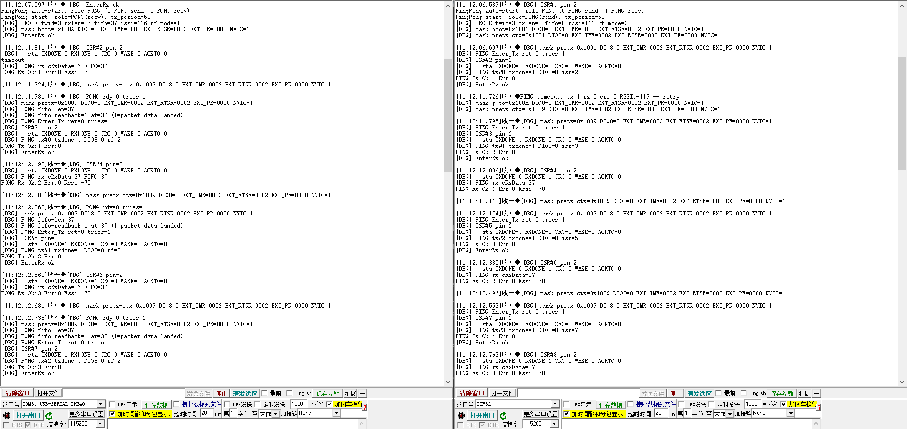

# Ai-SG01(PAN3120) on STM32F103C8T6 + FreeRTOS —— PING/PONG 双板对测

FreeRTOS + AT 固件，内置 PING/PONG 自动对测：上电按角色开始收发，不依赖串口下发指令。两块板一 PING 一 PONG 即可跑通链路。

- 模组：Ai-SG01（PAN3120，普通版引脚：nRST = PB0，不含 GC1131 前端驱动）
- MCU：STM32F103C8T6，72 MHz
- 工程：Keil MDK，`Project.uvprojx`，Device `STM32F103C8`
- 串口：USART1 = PA9 / PA10，115200-8-N-1

---

## 1. 目录结构

```
STM32F103C8T6-FreeRTOS-Demo/
├── Project.uvprojx
├── build.cmd                  # 一键编 PING / PONG（依赖 gcc/build.ps1）
├── Start/ Library/ hal_compat/
├── BSP/ PAN312x/ FreeRTOS/
├── User/
│   ├── main.c
│   ├── pingpong_config.h      # 唯一需要改的角色开关
│   └── at_command_firmware.c  # 固件主体（含 PINGPONG 状态机、AT+PINGPONG）
└── Objects/
    ├── Project_PING.hex       # 预编译：PING（发送端）
    ├── Project_PONG.hex       # 预编译：PONG（接收端）
    └── Project.hex
```

## 2. 引脚

| 信号 | STM32F103C8T6 |
|------|---------------|
| CSN / SCK / MISO / MOSI | PA4 / PA5 / PA6 / PA7 |
| nRST | PB0 |
| DIO8 / IRQ | PB1 |
| 其余 DIO / GPIO | PB10、PB11、PA11、PA12、PB14 |
| GREEN_LED / BLUE_LED | PA8 / PB15 |
| USART1 | PA9 / PA10 |

## 3. 角色配置

[`User/pingpong_config.h`](User/pingpong_config.h) 只有一个变量：

```c
#define PINGPONG_ROLE   1    // 0 = PING 发送端，1 = PONG 接收端
```

- 默认 **1 = PONG**。两块板分别烧 0 和 1。
- 不想改源码，可直接烧 `Objects/Project_PING.hex` / `Project_PONG.hex`。
- 运行中可用 `AT+PINGPONG 0|1` 切换，`AT+PINGPONG?` 查询角色与运行状态。

## 4. 任务与参数

| 项目 | 值 |
|------|-----|
| 任务 | `AiSG01`（Firmware_Task），栈 1024 字，优先级 2 |
| 堆 | `configTOTAL_HEAP_SIZE = 12 * 1024` |
| 射频 | 490.3 MHz、2FSK、50 kbps、±25 kHz、`POWER_LDO_0402` + `POWER_20dBm` |
| 发包周期 | 50 ms（`tx_period`） |

## 5. 编译与烧录

1. Keil 打开 `Project.uvprojx`，按 `PINGPONG_ROLE` 编两块固件；或用预编译 hex 直接烧。
2. `build.cmd` 是 GCC 命令行脚本（`build.cmd 0` / `build.cmd 1`），但它调用 `gcc/build.ps1`，**本工程未随附 `gcc/` 目录**；要用命令行构建，先从 [`../STM32F103C8T6-FreeRTOS-AT-Command/gcc/`](../STM32F103C8T6-FreeRTOS-AT-Command/gcc/) 复制一份过来。
3. ST-LINK 烧录后看串口收发计数：PING 侧发、PONG 侧回，计数同步增长即链路正常。

## 6. 实测日志

一块板烧 PONG、一块烧 PING，上电自动开跑：`Demo auto-start, role=PONG` / `role=PING`，之后 `PING Tx` 与 `PONG Rx` 计数逐包递增，`Err: 0`。



- 日志里的 `[DBG]` 行是包级调试输出（mask、FIFO 指针、IRQ 状态、tries），只在调试期打开。
- 左右两侧计数长期保持同步、没有丢包跳号，即链路稳定。

## 7. 备注

- 本工程按普通 Ai-SG01 引脚定义，不含 GC1131 前端驱动；P 版硬件请用 [`../STM32F103C8T6-AT-Command/`](../STM32F103C8T6-AT-Command/)。
- 单载波测试见 [`../STM32F103C8T6-FreeRTOS-Single-Carrier/`](../STM32F103C8T6-FreeRTOS-Single-Carrier/)；纯 AT 版见 [`../STM32F103C8T6-FreeRTOS-AT-Command/`](../STM32F103C8T6-FreeRTOS-AT-Command/)。
