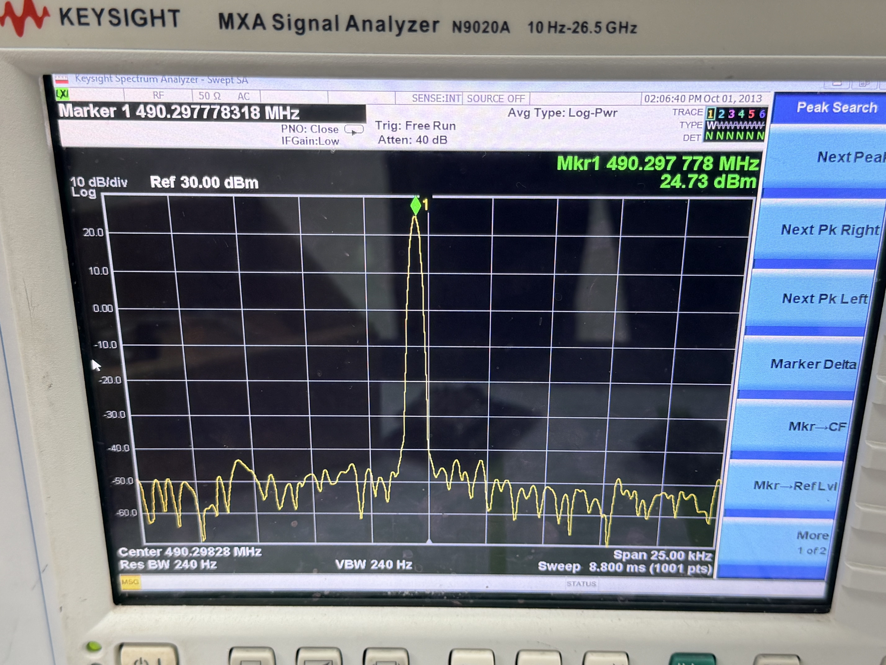

# Ai-SG01(PAN3120) on STM32F103C8T6 + FreeRTOS —— 单载波（CW）测试

FreeRTOS + AT 固件，打开 `CARRIER_AUTO_ON_BOOT` 后**上电直接进入未调制单载波**（等同 `AT+ENTERCARRIER` 的状态并保持），用于载波功率、频率容限、杂散测试；FreeRTOS 照常调度，用来证明带调度器时射频状态不被改写。

- 模组：Ai-SG01（PAN3120，普通版引脚：nRST = PB0，不含 GC1131 前端驱动）
- MCU：STM32F103C8T6，72 MHz
- 工程：Keil MDK，`Project.uvprojx`，ARM-GNU 工具链
- 串口：USART1 = PA9 / PA10，115200-8-N-1

---

## 1. 目录结构

```
STM32F103C8T6-FreeRTOS-Single-Carrier/
├── Project.uvprojx
├── build.cmd                  # 一键 GCC 构建（clean 参数可全量重编）
├── gcc/                       # 启动文件、链接脚本、syscalls、build.ps1 + 构建日志
├── Start/ Library/ hal_compat/
├── BSP/ PAN312x/ FreeRTOS/
├── User/
│   ├── main.c
│   ├── carrier_config.h       # CARRIER_AUTO_ON_BOOT（默认 1）
│   ├── pingpong_config.h      # Demo 角色保留，CW 模式下不生效
│   ├── at_command_firmware.c  # 固件主体 + Carrier_Enter_*
│   └── stm32f10x_it.c / stm32f10x_conf.h
└── Objects/
```

## 2. 引脚

| 信号 | STM32F103C8T6 |
|------|---------------|
| CSN / SCK / MISO / MOSI | PA4 / PA5 / PA6 / PA7 |
| nRST | PB0 |
| DIO8 / IRQ | PB1 |
| 其余 DIO / GPIO | PB10、PB11、PA11、PA12、PB14 |
| GREEN_LED / BLUE_LED | PA8 / PB15 |
| USART1 | PA9 / PA10 |

## 3. 载波配置

[`User/carrier_config.h`](User/carrier_config.h)：

```c
#define CARRIER_AUTO_ON_BOOT   1   // 1 = 上电进 CW；0 = 回到 Demo 自动对测
```

启动时 `Carrier_Enter_Default()` 会停掉 Timer1 / Timer2、关闭 PINGPONG 状态机、清唤醒标志，再进 `Carrier_Enter_Now()` 并置 `g_carrier_active`，之后禁止其它机制改写 RF 工作状态。

| 项目 | 值 |
|------|-----|
| 频率 | 490.3 MHz（`FrequencyBase = 490300000`） |
| 调制 | 2FSK（CW 时不加载调制数据） |
| 速率 / 频偏 | 50 kbps / 25 kHz（CW 下不体现） |
| 功率 | `POWER_LDO_0402` + `POWER_20dBm` |
| 配置 | Flash `0x0800FC00`，带 CRC |

## 4. 任务结构

| 项目 | 值 |
|------|-----|
| 任务 | `AiSG01`（Firmware_Task），栈 1024 字，优先级 2 |
| 堆 | `configTOTAL_HEAP_SIZE = 12 * 1024` |
| 串口 | 115200-8-N-1，可继续发 AT 查询，但 RF 已锁在载波态 |

## 5. 编译与烧录

1. Keil 打开 `Project.uvprojx` 直接 Rebuild；或命令行：

```powershell
.\build.cmd          # 编译
.\build.cmd clean    # 全量重编
```

2. 产物 `gcc/build/Project.elf` / `Project.hex`（Keil 构建则在 `Objects/`）。
3. ST-LINK 下载，上电即持续输出载波；接频谱仪看频率、功率与杂散。

## 6. 频谱实测（窄带扫频）

Keysight 扫频式频谱仪，Ref 30 dBm / 10 dB/div / 衰减 40 dB，中心 490.30 MHz、Span 25 kHz、RBW = VBW 240 Hz；标记 `Mkr1 490.297778 MHz`，峰值 **24.73 dBm**。



- 单根谱线、无调制旁瓣，符合 CW 预期；OBW 必须用调制连续发射另测。
- 比 AI8051U 单载波工程高约 1.2 dB，比较时保持同一块板、同一天线、同一功率档。
- 实测频点比设定低约 2.4 kHz，属晶振误差，报告按实测值记录。

## 7. 备注

- 未调制载波只有单根谱线，**不能**用来测占用带宽；OBW 需要调制连续发射，本工程不提供。
- 已存过 Flash 配置的板子会读回旧频点/功率，换参数先 `AT+CONFIGRESET` 或改 `DeviceConfig_Init()` 默认值再烧。
- 本工程按普通 Ai-SG01 引脚定义，不含 GC1131 前端驱动；P 版硬件请用 [`../STM32F103C8T6-AT-Command/`](../STM32F103C8T6-AT-Command/)。
