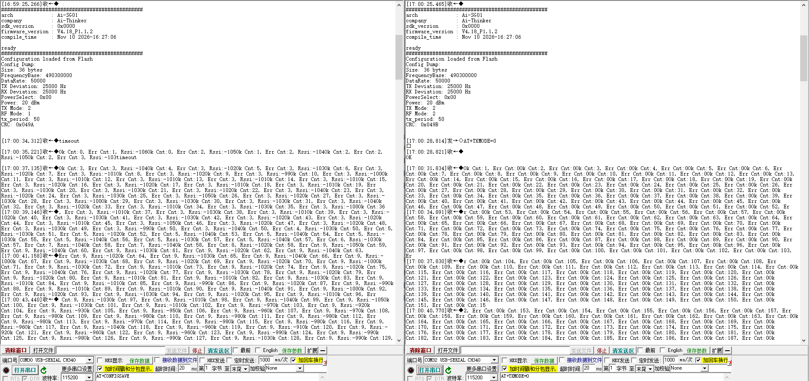
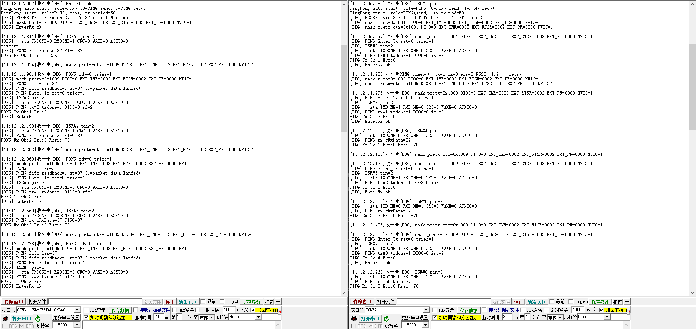
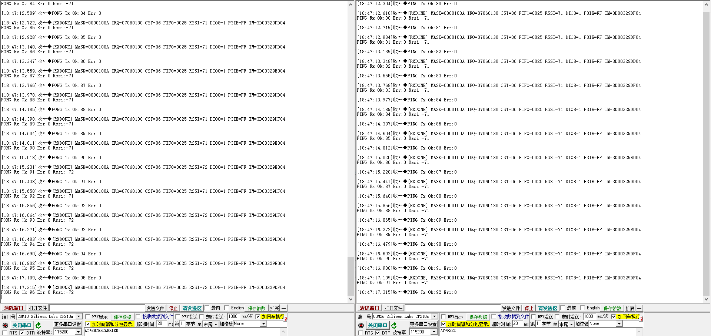
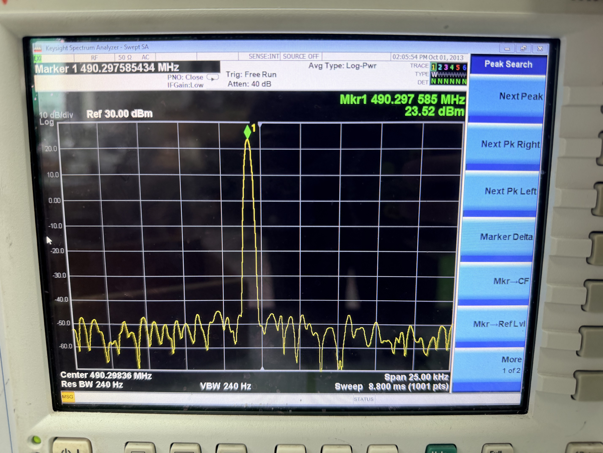
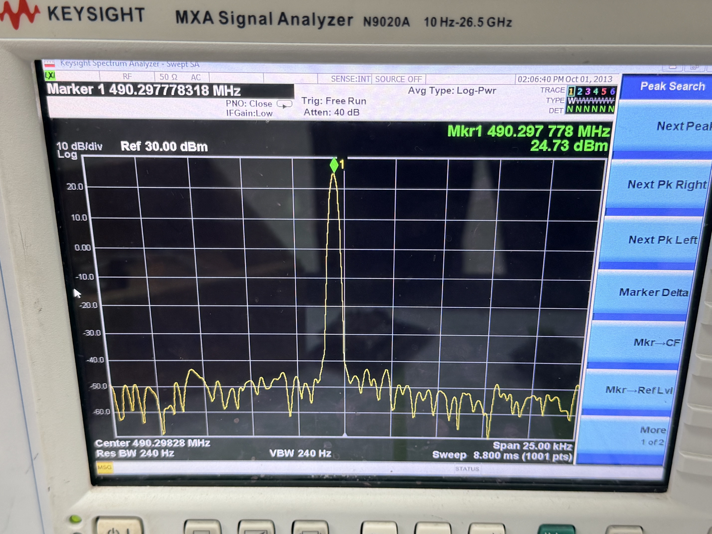

# Ai-Thinker RF433 Driver

**Ai-Thinker RF433 Driver** — driver and example firmware for the Ai-Thinker 433 MHz module family. Two modules on **PAN3120** (Panchip Sub-1G transceiver), seven projects: **Ai-SG01** (plain module) and **Ai-SG01-P** (module with GC1131 RF front-end).

> Datasheets, pinouts, certification material and the rest of the official documentation live at **[docs.ai-thinker.com/rf433](https://docs.ai-thinker.com/rf433/)** (Ai-Thinker RF433 series documentation). This repository only ships drivers and example firmware; hardware specs follow the official site.

---

## 1. Repository Layout

### [Ai-SG01-P](https://docs.ai-thinker.com/rf433/)

> Directory: [`Ai-SG01-P/`](Ai-SG01-P/)

| Directory | MCU / Toolchain | Contents | Project file |
|-----------|-----------------|----------|--------------|
| [`STM32F103C8T6-AT-Command`](Ai-SG01-P/STM32F103C8T6-AT-Command/) | STM32F103C8T6 / STM32Cube HAL + Keil (ARM-ADS) | P-variant AT firmware: drives GC1131, reports power with `POWER_OFFSET 27` dB | `MDK-ARM/Ai-SG01-P.uvprojx` |
| [`AI8051U-Demo`](Ai-SG01-P/AI8051U-Demo/) | AI8051U-34K64 / Keil C51 (C351), 33.1776 MHz | AT firmware ported to AI8051U plus PING/PONG two-board auto test | `AI8051U-AISG01.uvproj` |
| [`AI8051U-Single-Carrier`](Ai-SG01-P/AI8051U-Single-Carrier/) | AI8051U-34K64 / Keil C51 (C351) | Same framework with `CARRIER_AUTO_ON_BOOT = 1`: unmodulated carrier right after boot | `AI8051U-AISG01.uvproj` |
| [`STM32F103C8T6-FreeRTOS-AT-Command`](Ai-SG01-P/STM32F103C8T6-FreeRTOS-AT-Command/) | STM32F103C8T6 / Keil MDK (ARM-GNU) + FreeRTOS | AT firmware inside a FreeRTOS task, no auto test; `gcc/` build chain included | `Project.uvprojx` |
| [`STM32F103C8T6-FreeRTOS-Demo`](Ai-SG01-P/STM32F103C8T6-FreeRTOS-Demo/) | STM32F103C8T6 / Keil MDK + FreeRTOS | Same plus PING/PONG role (`pingpong_config.h`, default PONG), prebuilt PING/PONG hex | `Project.uvprojx` |
| [`STM32F103C8T6-FreeRTOS-Single-Carrier`](Ai-SG01-P/STM32F103C8T6-FreeRTOS-Single-Carrier/) | STM32F103C8T6 / Keil MDK (ARM-GNU) + FreeRTOS | Locks onto an unmodulated carrier after boot for carrier / frequency / spurious tests | `Project.uvprojx` |

### [Ai-SG01](https://docs.ai-thinker.com/rf433/)

> Directory: [`Ai-SG01/`](Ai-SG01/)

| Directory | MCU / Toolchain | Contents | Project file |
|-----------|-----------------|----------|--------------|
| [`STM32F103C8T6-AT-Command`](Ai-SG01/STM32F103C8T6-AT-Command/) | STM32F103C8T6 / STM32Cube HAL + Keil uVision5 (ARM-ADS) | AT-command firmware for fixed-frequency, power, range, reliability and GPIO tests; usable as a factory firmware | `MDK-ARM/Ai-SG01.uvprojx` |

> Only [`Ai-SG01-P/STM32F103C8T6-AT-Command`](Ai-SG01-P/STM32F103C8T6-AT-Command/) carries the GC1131 front-end driver. The AI8051U and FreeRTOS ports follow the plain Ai-SG01 pinout (nRST = PB0), so the P-variant front-end stays uninitialised if they are flashed onto a P board.

- Base board: LoRa-Kit V1.0.0 + Ai-SG01 adapter board, pin-to-pin.
- All projects share the same `PAN312x` driver (`PAN312x_Driver.c/.h`, `PAN312x_Rf_CTK_Setting.c/.h`). Defaults: 490.3 MHz, 2FSK, 50 kbps, ±25 kHz deviation, `POWER_LDO_0402` + `POWER_20dBm`, config stored in Flash `0x0800FC00`.
- Each project folder has its own `README.md` covering layout, pins, parameters, building and flashing.
- `Ai-SG01/.../Core/Src/pull_distance_test_firmware.c` is range-test source and is not part of the Keil build.

### Test logs

**[`STM32F103C8T6-FreeRTOS-AT-Command`](Ai-SG01-P/STM32F103C8T6-FreeRTOS-AT-Command/)**

Two boards: the config is loaded back from Flash (490.3 MHz, 50 kbps, ±25 kHz, `+20 dBm`, TX Mode 2) and the UART keeps printing TX/RX counters.

**[`STM32F103C8T6-FreeRTOS-Demo`](Ai-SG01-P/STM32F103C8T6-FreeRTOS-Demo/)**

One board as PONG, one as PING, running the auto test; `PING Tx` / `PONG Rx` counters increase packet by packet with `Err: 0`.

**[`AI8051U-Demo`](Ai-SG01-P/AI8051U-Demo/)**

Two AI8051U boards (COM10 / COM26), PING/PONG counters rising together, `Err: 0`, RSSI around -71 dBm.

### Measured spectrum (single carrier)

Keysight swept spectrum analyser, Ref 30 dBm / 10 dB/div / 40 dB attenuation, Span 25 kHz, RBW = VBW 240 Hz, centred on 490.30 MHz.

**[`AI8051U-Single-Carrier`](Ai-SG01-P/AI8051U-Single-Carrier/)**

Marker `Mkr1 490.297585 MHz`, peak **23.52 dBm**.

**[`STM32F103C8T6-FreeRTOS-Single-Carrier`](Ai-SG01-P/STM32F103C8T6-FreeRTOS-Single-Carrier/)**

Marker `Mkr1 490.297778 MHz`, peak **24.73 dBm**.

- Both traces are unmodulated carriers: one line inside a 25 kHz span, so they cannot be used as occupied-bandwidth (OBW) evidence.
- The measured tone sits about 2.4 kHz below the 490.3 MHz setting, inside normal crystal tolerance; record the measured value in test reports.
- The two platforms differ by about 1.2 dB, which depends on power setting and front-end state; compare only on the same board and antenna setup.

---

## 2. Module Difference (Ai-SG01 vs Ai-SG01-P)

| Item | Ai-SG01 | Ai-SG01-P |
|------|---------|-----------|
| RF front-end | none | GC1131, modes SHUTDOWN / RECEIVE / TRANSMIT_BYPASS / TRANSMIT |
| TX power reporting | raw chip setting | `POWER_OFFSET 27` dB applied, `+POWERDBM` / `+POWERSELECT` output |
| GPIO | DIO0/DIO2/DIO10 in use, nRST on PB0 | those DIOs unused, nRST on PB14, freed pins drive GC1131 (CPS PB0 / CSD PB11 / CTX GPIO2) |
| Init | — | `bsp_InitGC1131()` called from the AT firmware start-up |

Flash the matching firmware for the module you have: a P board with the plain firmware behaves like a module without a PA/LNA, and a plain board with the P firmware drives pins that do not exist.

---

## 3. Building and Flashing

1. Open the project file listed above in Keil uVision5 (HAL projects: Device `STM32F103C8`, Define `USE_HAL_DRIVER,STM32F103xB`).
2. Rebuild, then flash with ST-LINK (SWCLK / SWDIO / 3V3 / GND); AI8051U needs STC-ISP plus a cold start.
3. FreeRTOS variants can be built from the command line with `gcc/build.ps1` / `build.cmd` (details in each project README).
4. AT command set: [`docs/Ai-SG01-AT-Commands.docx`](docs/Ai-SG01-AT-Commands.docx) and [`docs/Ai-SG01-P-AT-Commands.docx`](docs/Ai-SG01-P-AT-Commands.docx).
5. Wiring notes: [`docs/wiring.zh-CN.md`](docs/wiring.zh-CN.md).

---

## 4. Documents

| File | Contents |
|------|----------|
| [`docs/Ai-SG01-AT-Commands.docx`](docs/Ai-SG01-AT-Commands.docx) | AT command manual for Ai-SG01 firmware |
| [`docs/Ai-SG01-P-AT-Commands.docx`](docs/Ai-SG01-P-AT-Commands.docx) | AT command manual for Ai-SG01-P firmware (GC1131 and power reporting included) |
| [`docs/wiring.zh-CN.md`](docs/wiring.zh-CN.md) | LoRa-Kit base board / adapter / module wiring |

---

## 5. Notes

- The power printed over AT is the chip setting plus the P-variant offset, not a calibrated absolute power; measure with a spectrum analyser for compliance work.
- Single-carrier (CW) is unmodulated and shows one spectral line only — it cannot be used to demonstrate occupied bandwidth (OBW).
