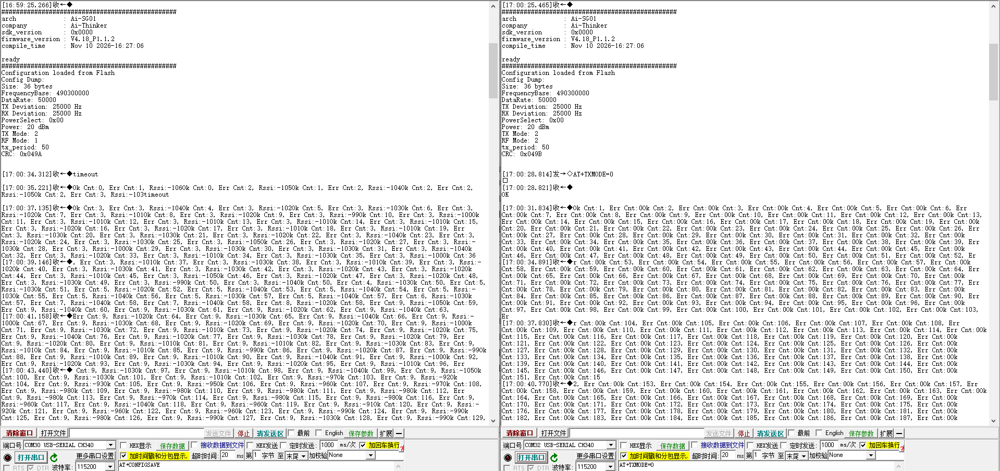
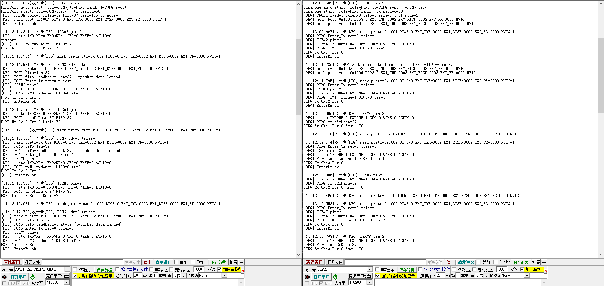
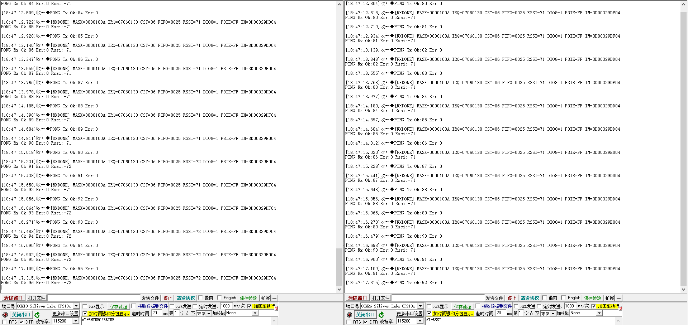
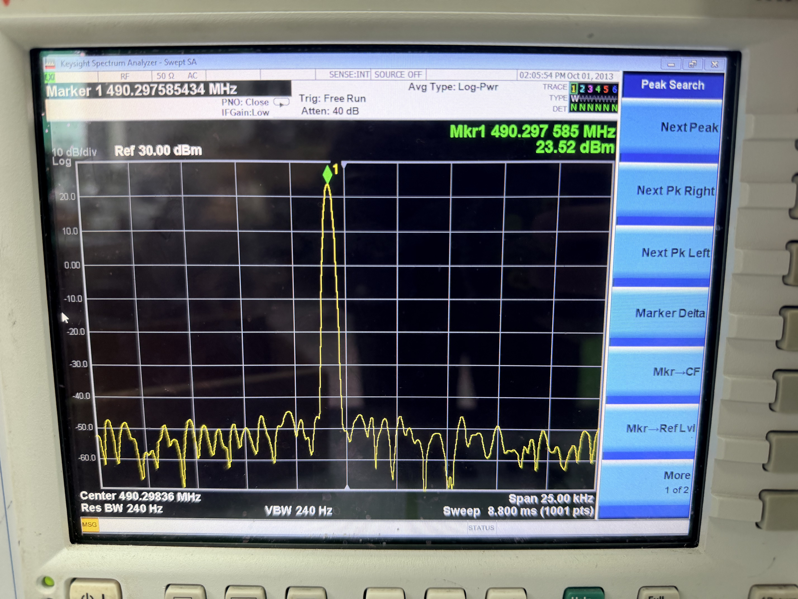
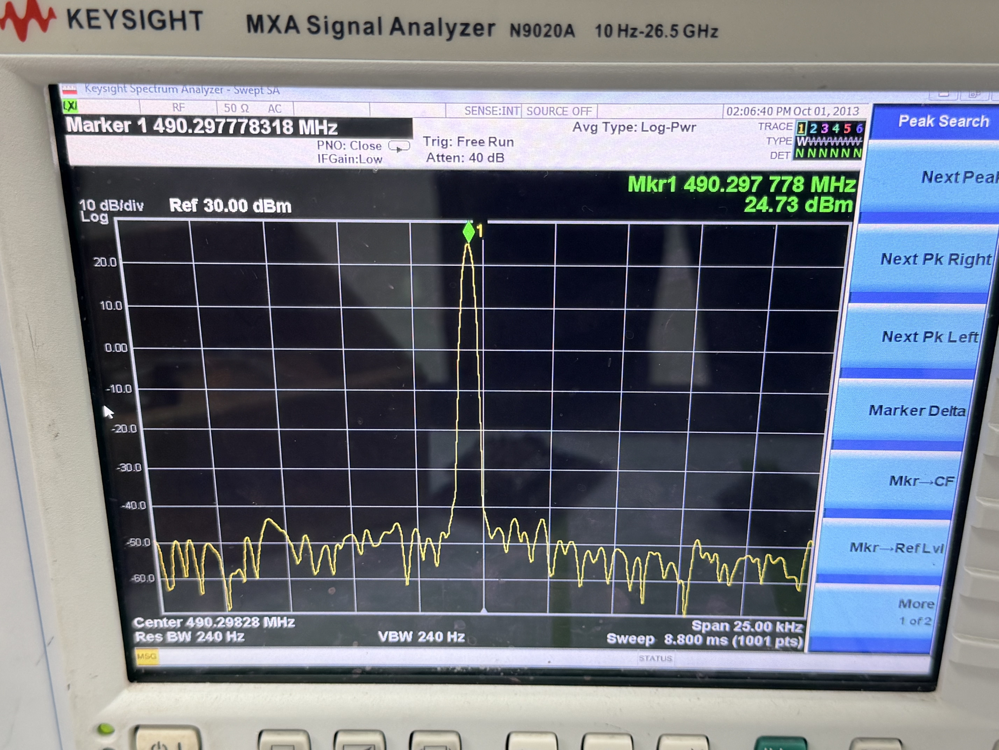

# Ai-Thinker RF433 Driver

**Ai-Thinker RF433 Driver** —— 安信可 433 MHz 系列模组的驱动与示例固件。**PAN3120**（磐启微 Sub-1G 收发器）上的两个模组、七个工程：**Ai-SG01**（基础模组）与 **Ai-SG01-P**（带 GC1131 射频前端的模组）。

> 模组规格书、引脚定义、认证资料等官方文档见 **[docs.ai-thinker.com/rf433](https://docs.ai-thinker.com/rf433/)**（安信可 RF433 系列模组官网文档）。本仓库只放驱动与示例固件，硬件参数以官网为准。

---

## 1. 仓库结构

### [Ai-SG01-P](https://docs.ai-thinker.com/rf433/)

> 目录：[`Ai-SG01-P/`](Ai-SG01-P/)

| 目录 | MCU / 工具链 | 内容 | 工程文件 |
|------|--------------|------|----------|
| [`STM32F103C8T6-AT-Command`](Ai-SG01-P/STM32F103C8T6-AT-Command/) | STM32F103C8T6 / STM32Cube HAL + Keil（ARM-ADS） | P 版 AT 固件：额外驱动 GC1131，功率按 `POWER_OFFSET 27` dB 上报 | `MDK-ARM/Ai-SG01-P.uvprojx` |
| [`AI8051U-Demo`](Ai-SG01-P/AI8051U-Demo/) | AI8051U-34K64 / Keil C51（C351），33.1776 MHz | AI8051U 上的 AT 固件移植 + PING/PONG 双板自动对测 | `AI8051U-AISG01.uvproj` |
| [`AI8051U-Single-Carrier`](Ai-SG01-P/AI8051U-Single-Carrier/) | AI8051U-34K64 / Keil C51（C351） | 同上框架，`CARRIER_AUTO_ON_BOOT = 1`，上电即未调制单载波 | `AI8051U-AISG01.uvproj` |
| [`STM32F103C8T6-FreeRTOS-AT-Command`](Ai-SG01-P/STM32F103C8T6-FreeRTOS-AT-Command/) | STM32F103C8T6 / Keil MDK（ARM-GNU）+ FreeRTOS | AT 固件跑在 FreeRTOS 任务内，纯 AT、无自动对测；含 `gcc/` 构建链 | `Project.uvprojx` |
| [`STM32F103C8T6-FreeRTOS-Demo`](Ai-SG01-P/STM32F103C8T6-FreeRTOS-Demo/) | STM32F103C8T6 / Keil MDK + FreeRTOS | 同上 + PING/PONG 角色（`pingpong_config.h` 默认 PONG），附预编译 PING/PONG hex | `Project.uvprojx` |
| [`STM32F103C8T6-FreeRTOS-Single-Carrier`](Ai-SG01-P/STM32F103C8T6-FreeRTOS-Single-Carrier/) | STM32F103C8T6 / Keil MDK（ARM-GNU）+ FreeRTOS | 上电锁定未调制单载波，用于载波/频率容限/杂散测试 | `Project.uvprojx` |

### [Ai-SG01](https://docs.ai-thinker.com/rf433/)

> 目录：[`Ai-SG01/`](Ai-SG01/)

| 目录 | MCU / 工具链 | 内容 | 工程文件 |
|------|--------------|------|----------|
| [`STM32F103C8T6-AT-Command`](Ai-SG01/STM32F103C8T6-AT-Command/) | STM32F103C8T6 / STM32Cube HAL + Keil uVision5（ARM-ADS） | AT 指令固件，可做定频、功耗、拉距、可靠性、GPIO 测试，可作出厂固件 | `MDK-ARM/Ai-SG01.uvprojx` |

> 只有 [`Ai-SG01-P/STM32F103C8T6-AT-Command`](Ai-SG01-P/STM32F103C8T6-AT-Command/) 带 GC1131 前端驱动；Ai8051U 与 FreeRTOS 几个移植工程沿用普通 Ai-SG01 的引脚定义（nRST = PB0），烧到 P 版硬件时前端不会被初始化。

- 底板：LoRa-Kit V1.0.0 + Ai-SG01 转接板，pin-to-pin 连接。
- 所有工程共用一套 `PAN312x` 驱动（`PAN312x_Driver.c/.h`、`PAN312x_Rf_CTK_Setting.c/.h`）；默认 490.3 MHz、2FSK、50 kbps、±25 kHz 频偏、`POWER_LDO_0402` + `POWER_20dBm`，配置存 Flash `0x0800FC00`。
- 每个工程目录下均有自己的 `README.md`：目录结构、引脚、参数、编译烧录与注意事项。
- `Ai-SG01/.../Core/Src/pull_distance_test_firmware.c` 是拉距测试源码，未参与 Keil 编译。

### 实测日志

**[`STM32F103C8T6-FreeRTOS-AT-Command`](Ai-SG01-P/STM32F103C8T6-FreeRTOS-AT-Command/)**

双板运行：上电从 Flash 读回配置（490.3 MHz、50 kbps、±25 kHz、`+20 dBm`、TX Mode 2），串口持续输出收发计数。

**[`STM32F103C8T6-FreeRTOS-Demo`](Ai-SG01-P/STM32F103C8T6-FreeRTOS-Demo/)**

一板 PONG、一板 PING，自动对测，`PING Tx` / `PONG Rx` 计数逐包递增，`Err: 0`。

**[`AI8051U-Demo`](Ai-SG01-P/AI8051U-Demo/)**

两块 AI8051U 板（COM10 / COM26）PING/PONG 计数同步增长，`Err: 0`，RSSI 约 -71 dBm。

### 频谱实测（单载波）

Keysight 扫频式频谱仪，Ref 30 dBm / 10 dB/div / 衰减 40 dB、Span 25 kHz、RBW = VBW 240 Hz，中心均在 490.30 MHz。

**[`AI8051U-Single-Carrier`](Ai-SG01-P/AI8051U-Single-Carrier/)**

标记 `Mkr1 490.297585 MHz`，峰值 **23.52 dBm**。

**[`STM32F103C8T6-FreeRTOS-Single-Carrier`](Ai-SG01-P/STM32F103C8T6-FreeRTOS-Single-Carrier/)**

标记 `Mkr1 490.297778 MHz`，峰值 **24.73 dBm**。

- 两张都是未调制载波，25 kHz 跨度内只有一根谱线，**不能**用作占用带宽（OBW）依据。
- 实测频点比设定的 490.3 MHz 低约 2.4 kHz，属于模块晶振误差范围，报告里按实测值记录。
- 两平台相差约 1.2 dB，与各自的功率档/前端状态有关，横向比较要在同一块板同一天线条件下做。

---

## 2. 两个模组的区别

| 项目 | Ai-SG01 | Ai-SG01-P |
|------|---------|-----------|
| 射频前端 | 无 | GC1131，模式 SHUTDOWN / RECEIVE / TRANSMIT_BYPASS / TRANSMIT |
| 功率上报 | 芯片原始设定值 | 叠加 `POWER_OFFSET 27` dB，输出 `+POWERDBM` / `+POWERSELECT` |
| GPIO | DIO0 / DIO2 / DIO10 在用，nRST 在 PB0 | 这些 DIO 不再使用，nRST 改到 PB14，空出的脚驱动 GC1131（CPS PB0 / CSD PB11 / CTX GPIO2） |
| 初始化 | — | `bsp_InitGC1131()` 在 AT 固件启动流程里调用 |

按模组型号烧对应工程：P 版烧普通固件会退化成无 PA/LNA 的基础模组；普通版烧 P 固件会去驱动不存在的引脚。

---

## 3. 编译与烧录

1. Keil uVision5 打开各工程表里列出的工程文件（HAL 工程 Device = `STM32F103C8`，Define = `USE_HAL_DRIVER,STM32F103xB`）。
2. Rebuild 后用 ST-LINK 烧录（SWCLK / SWDIO / 3V3 / GND）；AI8051U 用 STC-ISP 下载并冷启动。
3. FreeRTOS 工程可用 `gcc/build.ps1` / `build.cmd` 做命令行构建（细节见各工程 README）。
4. AT 指令手册：[`docs/Ai-SG01-AT-Commands.docx`](docs/Ai-SG01-AT-Commands.docx)、[`docs/Ai-SG01-P-AT-Commands.docx`](docs/Ai-SG01-P-AT-Commands.docx)。
5. 接线说明：[`docs/wiring.zh-CN.md`](docs/wiring.zh-CN.md)。

---

## 4. 文档

| 文件 | 内容 |
|------|------|
| [`docs/Ai-SG01-AT-Commands.docx`](docs/Ai-SG01-AT-Commands.docx) | Ai-SG01 固件 AT 指令手册（指令、参数、返回值） |
| [`docs/Ai-SG01-P-AT-Commands.docx`](docs/Ai-SG01-P-AT-Commands.docx) | Ai-SG01-P 固件 AT 指令手册（含 GC1131 与功率口径说明） |
| [`docs/wiring.zh-CN.md`](docs/wiring.zh-CN.md) | LoRa-Kit 底板 / 转接板 / 模组接线对照 |

---

## 5. 说明

- AT 指令打印的功率是芯片设定值叠加 P 版偏移，不是校准过的绝对功率；做认证或对比测试请用频谱仪实测。
- 单载波（CW）是未调制信号，只有单根谱线，不能用来论证占用带宽（OBW）。
